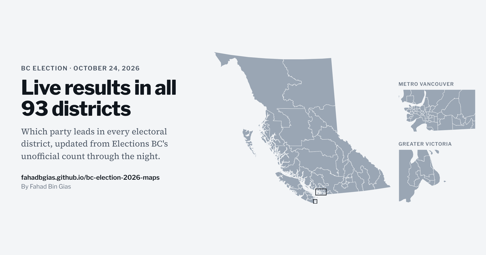
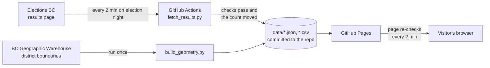

# BC Election Maps

Live, interactive maps of British Columbia's October 24, 2026 provincial general election: which party leads in each of the province's 93 electoral districts, updated from Elections BC's unofficial results.

**Live site:** https://fahadbgias.github.io/bc-election-2026-maps/



## What it shows

- A seat count by party, with the 47 seats needed for a majority marked, and each party's share of the vote.
- Every district coloured by the party whose candidate is ahead. A muted colour means the lead is under 5 points.
- Metro Vancouver with the Fraser Valley, and Greater Victoria, drawn at their own scale so their smaller districts are visible next to the province map.
- Select a district on any map, or in the lists, to see its candidates, votes, margin and how many ballot boxes have reported.
- A list of the closest races and a scrolling list of all 93 districts.
- The results are downloadable as a CSV: [`data/results.csv`](data/results.csv).

## How it stays up to date



Elections BC publishes election night results as static pages in a public storage container. The page's file name includes a number that isn't known until polls close, so `scripts/fetch_results.py` lists the container and picks the newest `Results_<number>_GE-2026-10-24_Candidate.html`. Then it:

1. Reads every district's candidates and votes, the party totals and how many advance-voting and Final Voting Day ballot boxes have reported.
2. Checks the data (below) and writes `data/results.json`, `data/results.csv` and a running `data/history.csv`.
3. Writes nothing if the count hasn't moved, so the workflow only commits real updates.

Elections BC's pages can't be read directly from another website's page, so the scraping runs on GitHub's servers. On election night, one workflow run keeps watching for several hours: it checks every 2 minutes, commits new numbers and starts a separate deploy workflow to republish the site. A schedule restarts the watcher if it stops, and it stops on its own once Elections BC marks the initial count complete. Every update is a commit, so the repo history is a record of how the count changed.

## The maps

The district boundaries come from Elections BC's 2023 redistribution (the 93 districts used in 2024 and 2026), published in the BC Geographic Warehouse. Legal district boundaries run out into the ocean, so `scripts/build_geometry.py` clips each district to land before simplifying it. It tries GeoBC's terrestrial boundary of the province first; that file is only offered over FTP, which GitHub's servers couldn't reach, so the current map uses Natural Earth's 1:10m land polygons. Then it simplifies each district (about 1 km for the province view, about 40 m for the close-ups) and turns it into compact SVG paths. The page draws the maps with no mapping library. Boundaries only change after a redistribution, so this runs by hand (**Actions → Build geometry**).

## Data checks

- **Matching:** every district on Elections BC's page must match one of the 93 districts on the map.
- **Totals:** each district's candidate votes must add up to the total Elections BC publishes for it.
- Anything that fails is listed on the page under "Data checks" and shown exactly as published. If the results page can't be read at all, the run fails and the previous numbers stay up.

## Run it yourself

```bash
python scripts/fetch_results.py          # refresh data/ from Elections BC
python -m unittest discover tests        # tests use a saved copy of the 2024 results page
python -m http.server 8000               # then open http://localhost:8000
```

Python 3.10+ with the standard library only. The exception is `scripts/build_geometry.py`, which needs `shapely` and `pyproj`.

## Sources

- Results: [Elections BC, 2026 Provincial General Election](https://elections.bc.ca/2026-provincial-election/), unofficial election night results. Initial count only: mail-in and absentee ballots are added in the final count, planned for November 6 to 10, 2026.
- Boundaries: [Elections BC, Provincial Electoral Districts, Electoral Boundaries Redistribution 2023](https://catalogue.data.gov.bc.ca/dataset/1cba4b16-263f-4d42-8d84-f5fecaa03d1a), via the BC Data Catalogue.
- Coastline: [Natural Earth, 1:10m land](https://www.naturalearthdata.com/downloads/10m-physical-vectors/10m-land/) (public domain). The build script prefers [GeoBC's terrestrial boundary of BC](https://catalogue.data.gov.bc.ca/dataset/province-of-british-columbia-boundary-terrestrial) when its server can be reached.

Independent analysis by [Fahad Bin Gias](https://www.linkedin.com/in/fahadbingias). Not affiliated with Elections BC.
